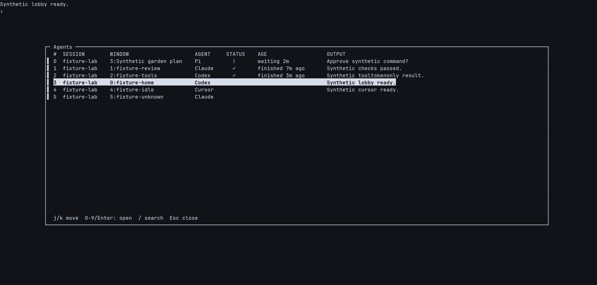
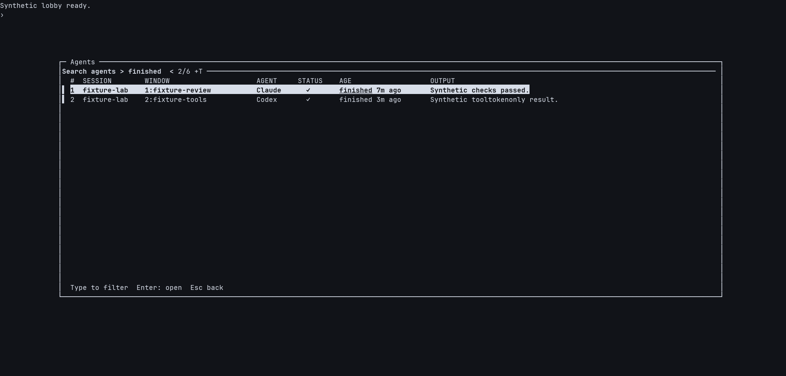

# Agent attention in tmux

`stow/scripts/ai-spinner.sh` keeps the existing spinner and adds unread attention:

- **Spinner:** an agent looks busy, using the existing Claude title and Codex,
  Cursor, and Pi terminal-text heuristics.
- **✓:** an observed busy agent stopped looking busy for three quiet
  observations (roughly two seconds from the first quiet observation).
  Its turn looks stopped, or it is showing a prompt the detector missed, and the
  output is unread. This does not prove task success;
  interrupted turns and errors can also stop activity.
- **!:** a known visible approval or question dialog needs input. This takes
  priority over activity in that pane, including Pi dialogs that retain a spinner.
- Indicators combine when different panes/windows are blocked, stopped, or working.

Window tabs, `prefix s` session and expanded window rows, and `prefix w` use the
same indicators. Expanded pane rows distinguish the individual agents too.
`prefix w` opens with windows collapsed. `prefix W` opens with every session and
window expanded, showing individual panes.
Inside either picker, `Alt` + `+` expands all items and `Alt` + `-` collapses them.
Stable option values refer to a shared hidden environment
variable for the animation frame; consumers expand them with `#{E:@ai_spinner}`
or `#{E:@ai_spinner_s}`. Frame updates use status-only refreshes, not option writes
that invalidate ordinary application panes. Stable idle and unread indicators do
not force repeated redraws. State/indicator transitions can still trigger tmux's
normal full redraw. A session retains its markers while any of its windows has
unread attention; visiting a different window in that session doesn't clear it.

Detection runs roughly once a second and animation roughly four times a second.
An agent's screen is captured again only after its window shows new output or
its title, size, or command changes; otherwise its previous verdict is reused.
Applying a scan reads pane state, windows, sessions, and client metadata in one
tmux call, and captured text is filtered in one pass.
Without terminal clients, detection and notifications continue but animation
stops. The internal frame is not exported to new pane processes.

## Agent popup

`prefix b` opens a centered, searchable list of AI panes across the current tmux
server. The columns are **Session**, **Window** (number and name), **Agent**,
**Status**, **Age**, and **Output**, with a **#** column labeling number shortcuts. Help stays at the
bottom, leaving the column headers above the list.
It reads the initial agent list and statuses before opening the popup, using the
same pane metadata as subsequent refreshes.

For recognized Pi processes, Window shows `number:conversation name` from Pi's
terminal title when its cwd suffix matches the pane's current directory. Unnamed,
invalid, or oversized titles fall back to the tmux window name. Claude, Codex,
Cursor, and ambiguous runtime processes use the window name. Titles never make
an otherwise unrecognized pane eligible. Names are resolved in the initial
snapshot and update through the existing refresh while open. The picker adds no
provider calls, transcript reads, cache, or separate timer. Name metadata shares
the existing five-second tmux query timeout; without a pane snapshot, the picker
reports its usual error. Search matches the displayed name.



The example uses synthetic conversations and output captured from the real popup.

It opens in navigation mode with your current agent pane highlighted. If your
current pane is not listed, it starts on the first row. Clicking a desktop
notification opens it highlighting the notifying agent instead (see
[Desktop notifications](#desktop-notifications)).

- `j` moves down; `k` moves up. Arrow keys work too.
- `0`–`9` immediately open the correspondingly labeled row. The first ten rows
  have shortcuts; use movement keys or search for the rest. Unavailable numbers
  leave the highlighted row unchanged.
- Enter opens the highlighted pane. Escape closes the popup without navigating.
- `/` enters search mode. Type to filter any column; letters and numbers are
  ordinary query text here. Search matches the five metadata columns, excluding the
  shortcut labels and Output. Enter opens the match. Escape clears the search and
  returns to navigation; another Escape closes the popup.

`prefix w` and `prefix W` keep their native tree behavior.
Popups and tree preview borders use the terminal's default foreground and
background. The shared config overrides tmux 3.8's gray defaults; older tmux
versions quietly skip the new tree border option.

Status uses the same symbols as the tmux tabs: **!** needs input, **✓** marks
unread stopped output, the spinner marks working, and idle is blank. Rows keep
that priority order. In search mode, fzf ranks matching rows. While open, the
picker reads the existing pane states and current spinner frame once a second.
It prepares updates in the background and reloads only changed snapshots, so
metadata queries do not block typing or movement. Overlapping polls are skipped.
It preserves your query and highlighted pane across status changes and
reordering. Closing the popup stops its refresh timer; the shared attention
monitor continues unchanged. Status can be filtered by its symbol. Seen but unanswered
dialogs still show **!**. **✓** does not mean task success. Opening or cancelling the
popup does not clear attention; visiting a window uses the usual acknowledgement
rules below.

Known Claude, Codex, Pi, and Cursor processes remain listed when idle. Native
Claude executables named with a version number are recognized too. Ambiguous
`node`, `bun`, and `uv` processes appear with a recognized attention state,
using their process name rather than guessing an agent. The existing monitor
remembers a recognized runtime in `@ai_agent_command`, so it remains listed when
idle and across reloads while its foreground command stays the same. Changing
the command clears that identity. Unrecognized runtime processes stay excluded;
already-idle processes need recognizable activity once to establish identity.
This uses the existing scan and adds no polling. Recognition remains heuristic;
a state is not proof of an AI process.
Pane titles alone do not establish agent identity. Long names can extend beyond
the popup width; wide Unicode characters can misalign the columns.

**Age** shows `waiting <1m`, `waiting 5m`, or `finished 5m ago`, using minutes,
hours, or days. It starts when the monitor observes a new input prompt or a
stopped turn. Reading output and restarting the monitor preserve the timestamp;
new work clears it. Already-idle agents with no observed completion have no age.
Completion timing includes the quiet-observation debounce. "Finished" means
the turn looks stopped, including errors or interruption, rather than task success.
The timestamp is cleared when the monitor observes a different foreground
command, and ignored by the picker if its recorded command does not match.

**Output** is a best-effort snippet of the latest visible output, including
tool output. The picker captures up to 80 visible rows per listed pane in one
additional batched tmux request, only when the picker lists or refreshes agents.
It keeps at most 100 printable characters on one line. Recognizable composers,
drafts, spinner lines, and footer controls are excluded. Ambiguous or unknown input layouts
leave Output blank; the snippet is not guaranteed to be an assistant message.
Missing or timed-out captures leave the metadata and navigation available.
Each optional capture or retry query has a 200 ms timeout. Column spacing
compresses when the client's popup width cannot fit the usual padding.
Output is not stored in pane options and does not change attention detection.



Linked panes appear once, preferring their name in your current session. Enter
rechecks pane identity, follows moved panes, preserves zoom, and reports a closed
pane instead of selecting something else. Navigation targets the invoking
client. Clients sharing the selected session share its active window and pane.
Linked windows also share their active pane across sessions, so selecting another
split changes that pane for other clients viewing the same linked window; their
session attachments stay unchanged.

### Installation

The popup needs [Python 3.8+](https://docs.python.org/3/whatsnew/3.8.html),
[fzf 0.73+](https://github.com/junegunn/fzf/releases/tag/v0.73.0), and
[tmux 3.3+](https://github.com/tmux/tmux/blob/3.3/CHANGES).
The helper must be linked on **each machine** before loading the new binding.
From the permanent dotfiles checkout, create the link if the destination is free:

```sh
mkdir -p "$HOME/.config/tmux/scripts"
ln -s "$PWD/stow/scripts/tmux-agent-picker" "$HOME/.config/tmux/scripts/tmux-agent-picker"
```

If the link already exists, inspect its target instead of overwriting it. The
binding calls Python explicitly; the helper does not need a separate PATH entry.
Do not use a temporary worktree as the installed source. Reload with `prefix q`
after installing the helper and applying the config. A missing fzf executable
produces a tmux message. With no agents, the popup stays open with an empty list and automatically loads
newly started agents; use Escape to close it.

## Acknowledgement and persistence

Both unread indicators clear when that window is shown in a focused attached tmux client,
provided its active pane is not in a picker or copy mode. A foreground completion
still makes a sound but is immediately considered seen. If multiple clients are
attached, viewing the window in any focused client acknowledges it. This is
window-level acknowledgement, not a guarantee that every split was read.
Zooming a pane still acknowledges the entire window. A seen input prompt stays
acknowledged while it remains open; polling and monitor reloads do not alert again.
When the agent resumes, a later prompt or completion can create new attention.

Starting work again supersedes that pane's previous check. Closing the pane
removes its state without creating another completion. Linked windows contribute
to each containing session, but their panes are processed only once per scan.

Unread state is stored in pane-local tmux options, so it survives **config reloads
and daemon restarts while the tmux server lives**. Reloading doesn't replay
already-issued notifications. On Linux, `flock` (util-linux) serializes daemon
handover so an in-flight completion cannot race a replacement. If the `flock`
executable is unavailable, Python 3 takes the lock and replaces itself with the
daemon, retaining its PID and lock descriptor. Scanner, sound, and notification
children do not hold that lock. A replacement prepares its scan directory and
checks lock support before requesting handover; a failed preparation leaves the
running monitor in place. Its empty `<socket>.ai-spinner.lock` file is
intentionally retained to keep concurrent waiters on the same inode. A pane's
window membership is checked inside tmux when persisting a transition, so moving
it mid-scan cannot acknowledge its old window. Aggregation can lag until the next
scan. Destroying/restarting the tmux server does not preserve attention.

This is heuristic monitoring, not lifecycle hooks. Very short work between scans
can be missed; changing an agent's UI wording can break detection. An unrecognized
idle agent does not get marked done just because the monitor starts. Failed
captures don't advance completion detection.

Input detection uses the most recent 20 nonempty screen lines. Claude requires
paired dialog controls, such as confirmation plus cancellation, permission choices,
or MCP input controls. Codex uses its approval/question footer or its `Action Required`
title, including when its npm launcher appears as `node`. Pi uses the standard extension selector/input hints, the installed
auto-permissions selector and note controls, and the questionnaire's controls.
A `π - ` title identifies Pi even behind a shell wrapper.
Ordinary prose mentioning permission or questions does not establish a blocker.
A later Claude/Codex composer, including typed input, makes earlier dialog controls stale. New or
custom dialog layouts and non-visible prompts may still fall back to `✓` after
activity stops. An unanswered question written as ordinary assistant prose is not
classified as a blocking dialog.

A disappearing input dialog uses the same three-observation debounce. A single
redraw does not produce another notification for the same prompt. If work resumes,
the spinner replaces it; if the turn settles, unread output becomes `✓`.

## Desktop notifications

Each newly quiet background pane can show an OS notification saying **Agent turn
finished**. A newly blocked background pane says **Agent needs input**. Both are
labeled with the window and pane indices, such as `W 1 P 2`. The existing
window-level acknowledgement rule suppresses popups for windows you are already
viewing. Popups do not add another sound. Simultaneous panes notify separately;
their existing sound stays coalesced. Dismissing a popup does not clear its marker.

Notifications are automatic. There is no binding shortcut or terminal-title
rewrite. The optional `stow/scripts/tmux-agent-notify` helper uses Python 3's
standard library. It resolves beside the spinner's real source, including when
the installed spinner is a Stow symlink. Missing Python on Linux, a missing helper,
failed notification commands, and unsupported platforms leave existing monitoring
and sound behavior intact. Immediate OS commands have a five-second timeout;
`terminal-notifier` delivery can wait for macOS permission dialogs in its
background worker without blocking the monitor or holding its handover lock.

| Platform | Delivery | Click |
| --- | --- | --- |
| Linux (Omarchy) | `notify-send` with an `omarchy-exec-argv` hint | Focuses Ghostty with `omarchy-hyprland-focus-app`, then opens the agent picker. |
| macOS with `terminal-notifier` | Native notification | Activates Ghostty, then opens the agent picker. |
| macOS without `terminal-notifier` | `osascript display notification` | Informational only. |

Clicking a notification opens the `prefix b` agent picker on the most recently
active tmux client, highlighting the notifying agent's row. Enter jumps to it;
Escape closes the picker without navigating. If that pane closed or is no longer
listed, the picker starts on its usual row. The click never navigates by itself,
so an old notification cannot move you anywhere unexpected. With no attached
client, the click only focuses Ghostty. Attention clears through the normal
focused-window rule, not directly from the click.

The click command carries the notifier's PATH, because `terminal-notifier` runs
it under launchd's minimal PATH, and runs the picker beside the helper's real
source. Omarchy's notification shell runs the `omarchy-exec-argv` hint itself,
including from notification history; other Linux notification daemons ignore the
hint and their popups stay informational. If the client already shows any tmux
popup, tmux keeps that popup (retitling it) instead of opening the picker. On a
machine with several Ghostty windows, Linux focuses the first one Hyprland reports.
No notification helper is installed automatically. On macOS, notification
permissions are controlled by the OS.

Disable only popups:

```sh
tmux set -g @ai_notifications off
```

Restore them:

```sh
tmux set -g @ai_notifications on
```

The config defaults to `on` with `set -qog`, preserving runtime overrides across
reloads. Sound has its separate control below.

## Sound

The config defaults to `canberra-gtk-play -i complete` (Linux/libcanberra with a
sound theme containing the `complete` event). There is one asynchronous sound
command per scan containing new completions, so simultaneous completions are
coalesced. Sound failures don't stop monitoring. Tests replace the audio command
with a recorder and do not play audio.

Mute:

```sh
tmux set -g @ai_attention_command ''
```

Restore:

```sh
tmux set -g @ai_attention_command 'canberra-gtk-play -i complete'
```

Use another installed player if preferred:

```sh
tmux set -g @ai_attention_command 'pw-play /absolute/path/to/chime.oga'
```

This option is trusted local **shell code**, not agent-supplied text. Config uses
`set -qog` so reloading preserves runtime sound overrides without an already-set error. To apply a different
command immediately, use `set -g` as above rather than only editing the default.

## Verification and rollout

```sh
python3 -m unittest discover -s tests -v
sh -n stow/scripts/ai-spinner.sh
python3 -c 'from pathlib import Path; p = Path("stow/scripts/tmux-agent-notify"); compile(p.read_text(), str(p), "exec")'
git diff --check
```

The attention tests create private tmux servers and PTY clients. They exercise
real detection, indicators, picker rendering, acknowledgement, notifications,
in-flight reload/pane-movement races, status-only animation and bounded polling;
they never source the live config or run real AI agents. Verified with tmux 3.7c
and Linux `flock`. Notification tests record OS command boundaries and execute
captured callbacks against real private tmux servers; they do not show live
desktop popups. The attention suite also runs on macOS with tmux 3.8, BSD awk,
and the Python lock fallback, and on Linux with tmux 3.5a, mawk, and `flock`.
macOS and Linux notification commands use controlled fixtures; click tests run
the captured click command and accept the real picker popup. Native desktop
delivery, Ghostty activation, and Omarchy's click handling still need a desktop
smoke check.

For a smoke check, use a private tmux socket in Ghostty with these scripts. Run
synthetic work in a background window, then confirm one native popup and an
unread check. Click it and confirm Ghostty comes forward with the agent picker
open on the notifying agent; Enter should jump there. On Omarchy, repeat the click
from notification history. Disable popups and confirm the check still works.
Stop that private server when finished.

A worktree checkout does **not** update existing Stow links: verify their actual
targets. Test in an isolated server first. Only after approving and applying the
change to the Stow source should you reload live tmux with `prefix q`. Upgrade the
script and format consumers together. For the first upgrade from a pre-lock
daemon, pause it with `tmux set -g @ai_spinner_pid paused`, verify that the old
daemon has exited, then reload; an old binary does not participate in the new
handover lock. Before live rollout, save copies of the current script and tmux
config. Rollback means restoring those two files and reloading; no sessions need
to be killed.
